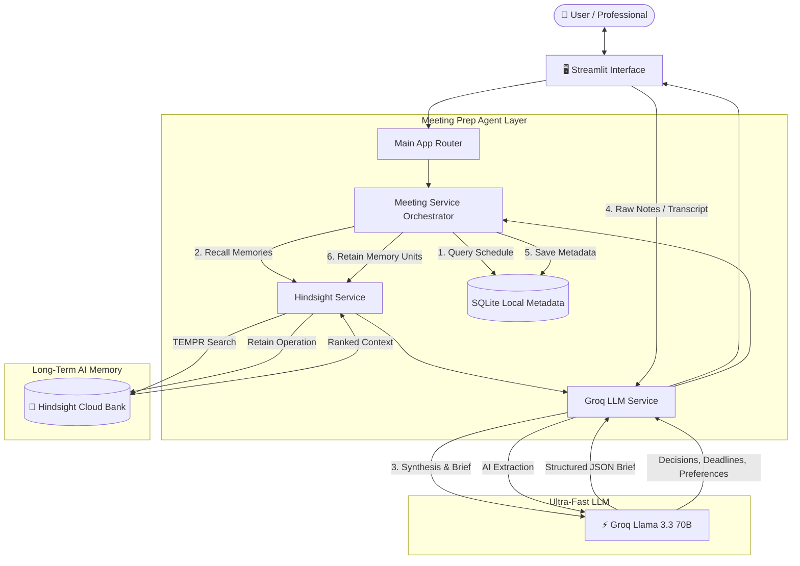

# 🎯 Meeting Prep Agent

> **AI-Powered Meeting Assistant with Persistent Long-Term Memory via Hindsight Cloud and Fast Reasoning via Groq**

[](https://www.python.org/)
[](https://streamlit.io/)
[](https://hindsight.vectorize.io/)
[](https://groq.com/)
[](LICENSE)

---

## 📌 Problem Being Solved
Professionals spend hours across recurring client, stakeholder, and team meetings. Traditional notes end up trapped in scattered documents or forgotten in messaging threads. Before each meeting, people struggle to remember:
* *What did we agree to three weeks ago?*
* *Did the target deadline move from October 15 to October 25?*
* *What specific communication style or cadence does this client prefer?*
* *What blockers or authentication issues are still unresolved?*

Standard RAG (Retrieval-Augmented Generation) or stateless chatbots cannot effectively track changing requirements, relationship nuances, or evolving timelines.

**Meeting Prep Agent** solves this by establishing an autonomous **memory loop**:
$$\text{REMEMBER} \longrightarrow \text{RECALL} \longrightarrow \text{UNDERSTAND CONTEXT} \longrightarrow \text{PREPARE BETTER} \longrightarrow \text{LEARN AGAIN}$$

---

## 💡 The Core Value Proposition
The agent becomes progressively more intelligent and tailored over time because it maintains **persistent semantic memory** in **Hindsight Cloud**:

1. **Meeting 1:** Client mentions initial requirements, launch deadline (Oct 15), and a preference for concise bulleted updates. *Stored in Hindsight.*
2. **Meeting 2:** Before the meeting, the agent recalls Meeting 1 context. In the meeting, the client expands scope (regional filters), shifts a deadline (Oct 25), and encounters an Okta authentication blocker. *Stored in Hindsight.*
3. **Meeting 3:** The agent recalls **BOTH** old and new memories. It generates a brief that flags the shifted deadline, the Okta blocker, and the client's preferred communication style, explicitly highlighting **"What Changed Since Last Meeting"**!

---

## 🏗️ Architecture & Agent Workflow



### Distinction Between SQLite and Hindsight Cloud
* **SQLite (`data/meeting_prep.db`):** Stores local application metadata (client IDs, meeting schedules, follow-up checklist state, cached briefs).
* **Hindsight Cloud:** Serves as the **persistent long-term memory engine**. It stores decomposed semantic memory units (decisions, preferences, commitments, blockers) and performs TEMPR multi-strategy recall (Semantic, BM25, Graph/Entity, Temporal) across historical meetings.

---

## 🛠️ Technology Stack

| Component | Technology | Role |
| :--- | :--- | :--- |
| **Frontend** | Streamlit | Responsive, high-productivity web UI with dark-mode executive styling |
| **Long-Term Memory** | [Hindsight Cloud](https://hindsight.vectorize.io/) (`hindsight-client`) | Persistent memory bank, TEMPR recall, reflection, entity extraction |
| **LLM Reasoning** | [Groq API](https://groq.com/) (`groq`) | Sub-second inference for note structuring, brief synthesis (`llama-3.3-70b-versatile`) |
| **Local Metadata** | SQLite | Application metadata, relational links, action logging |
| **Validation** | Pydantic v2 | Strict JSON schema definitions, memory payloads, and brief models |
| **Configuration** | `python-dotenv` | Secure environment variable handling |

---

## 📂 Project Structure

```
MeetingPrep_HWH/
├── .env.example                # Template for required API keys
├── .gitignore                  # Git ignore rules (protects .env and *.db)
├── requirements.txt            # Python dependencies
├── README.md                   # Complete documentation & demo guide
├── app/
│   ├── __init__.py
│   ├── config.py               # Settings loader & validation
│   ├── main.py                 # Streamlit application entry point & routing
│   ├── database/
│   │   ├── __init__.py
│   │   └── db.py               # SQLite schema init & CRUD operations
│   ├── models/
│   │   ├── __init__.py
│   │   └── schemas.py          # Pydantic data schemas & memory payload models
│   ├── services/
│   │   ├── __init__.py
│   │   ├── hindsight_service.py# Hindsight Cloud retain/recall/reflect client
│   │   ├── groq_service.py     # Groq LLM note extraction & brief generation
│   │   └── meeting_service.py  # High-level orchestrator & demo seed engine
│   ├── utils/
│   │   ├── __init__.py
│   │   ├── prompts.py          # System prompts for extraction, prep & reflection
│   │   └── helpers.py          # JSON parsers, chunk builder & Markdown formatter
│   └── ui/
│       ├── __init__.py
│       ├── styles.py           # Custom CSS styling (badges, cards, banners)
│       ├── dashboard.py        # Executive dashboard & metrics view
│       ├── meeting_prep.py     # Pre-meeting preparation & brief view
│       ├── post_meeting.py     # Post-meeting note capture & AI auto-extract
│       ├── memory_explorer.py  # Hindsight memory graph & search explorer
│       ├── clients.py          # Client & contact management
│       └── demo_walkthrough.py # Interactive 4-step progressive demo story
└── tests/
    ├── __init__.py
    ├── test_db.py              # SQLite CRUD and schema tests
    ├── test_prompts_and_helpers.py # Prompt & helper utility tests
    ├── test_schemas.py         # Pydantic schema validation tests
    ├── test_services.py        # Graceful error handling tests
    └── test_workflow.py        # Full workflow integration tests
```

---

## 🚀 Installation & Setup

### 1. Clone & Setup Virtual Environment
```bash
git clone https://github.com/your-repo/MeetingPrep_HWH.git
cd MeetingPrep_HWH

# Create and activate virtual environment
python -m venv venv
# On Windows:
.\venv\Scripts\activate
# On macOS/Linux:
source venv/bin/activate
```

### 2. Install Dependencies
```bash
pip install -r requirements.txt
```

### 3. Configure Environment Variables
Create a `.env` file in the root directory:
```bash
cp .env.example .env
```

Edit `.env` with your API keys:
```ini
# Groq API (Free key from https://console.groq.com/keys)
GROQ_API_KEY=gsk_your_groq_api_key_here
GROQ_MODEL=llama-3.3-70b-versatile

# Hindsight Cloud (From https://hindsight.vectorize.io)
HINDSIGHT_API_KEY=your_hindsight_api_key_here
HINDSIGHT_BANK_ID=meeting-prep-agent
HINDSIGHT_API_URL=https://api.hindsight.vectorize.io

# SQLite Metadata Path
SQLITE_DB_PATH=data/meeting_prep.db
```

> **Note:** You can also enter API keys directly inside the Streamlit sidebar settings at runtime.

---

## 🎬 Running the Application

Launch the Streamlit interface:
```bash
streamlit run app/main.py
```

Open your browser at `http://localhost:8501`.

---

## 🌟 The "WOW" Demo Walkthrough: ABC Technologies

The application includes a built-in, 1-click **Interactive Demo Walkthrough** located under **"🚀 Demo Walkthrough (Story Mode)"** in the navigation menu.

### Step-by-Step Scenario:

1. **Step 1: Meeting 1 Kickoff (Initial Scope)**
   * **Action:** Click **"Execute Step 1: Retain Meeting 1 in Hindsight"**.
   * **Context:** Kickoff with Sarah Chen (VP of Engineering, ABC Technologies).
   * **Memory Learned:** Custom analytics dashboard needed, launch deadline is **October 15**, API documentation required, client prefers **concise bulleted updates**.

2. **Step 2: Prepare Meeting 2 (Recalling M1 Context)**
   * **Action:** Switch to Step 2 and click **"Execute Step 2: Prepare Meeting 2 Brief"**.
   * **Result:** The agent queries Hindsight Cloud, recalls the Meeting 1 context, and generates a tailored brief referencing the Oct 15 deadline and concise communication preference.

3. **Step 3: Meeting 2 Outcomes (Scope Expansion & Deadline Shifts)**
   * **Action:** Switch to Step 3 and click **"Execute Step 3: Retain Meeting 2 Updates into Hindsight"**.
   * **Context:**
     * Dashboard scope expanded to include **regional filtering (NA & EU)**.
     * API documentation deadline shifted to **October 25**.
     * Sarah requests updates **twice per week** (Tuesday & Thursday).
     * Blocker: Enterprise **Okta SSO authentication** blocked by IT security review.

4. **Step 4: Prepare Meeting 3 (Witnessing Old + New Evolved Memory)**
   * **Action:** Switch to Step 4 and click **"Execute Step 4: Prepare Meeting 3"**.
   * **Result:**
     * Recalls **both Meeting 1 and Meeting 2** from Hindsight.
     * In the brief:
       * 🔄 **What Changed Since Last Meeting:** Explicitly highlights the API documentation deadline shift and regional scope addition.
       * ⚠️ **Unresolved Issues & Blockers:** Flags the Okta SSO blocker.
       * 💡 **Client Preferences:** Synthesizes the twice-weekly update cadence and concise format.
       * ❓ **Suggested Questions:** Recommends targeted questions regarding Okta security review status.

---

## 🧪 Running Automated Tests

Run the full pytest suite:
```bash
pytest -v
```

All 15 unit and integration tests verify:
- SQLite schema initialization, cascading deletes, and CRUD operations
- Memory payload chunking and semantic tag generation
- JSON parsing resiliency and Markdown formatting
- Graceful degradation when API keys are unconfigured
- Complete end-to-end meeting preparation and retention workflows

---

## 🔒 Security Best Practices
* **No hardcoded secrets:** All API credentials are read from `.env` or sanitized environment variables.
* **Strict `.gitignore`:** Pre-configured to prevent `.env`, local SQLite databases (`*.db`), and cached artifacts from ever being committed.
* **Non-destructive operations:** Database resets and demo seeds are isolated to local state.

---

## 📚 Resources & Documentation
* [Vectorize.io Hindsight Documentation](https://hindsight.vectorize.io/)
* [Vectorize.io Hindsight GitHub](https://github.com/vectorize-io/hindsight)
* [Groq Cloud Documentation](https://console.groq.com/docs)
* [Streamlit Documentation](https://docs.streamlit.io/)
